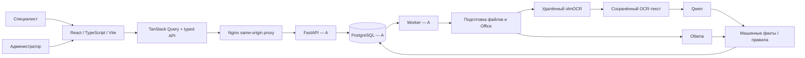

# Архитектура и границы реализации

Дата: 10.10.2026. Детальная проектная архитектура — [specs.md](specs.md). Сейчас в checkout реализован frontend M14 и подготовлены данные каталога; серверные компоненты на схеме — план участника A.

Серверные данные находятся в TanStack Query; формы держат отдельный черновик в React state. Клиент не вычисляет арифметический verdict и не устанавливает pass. Ответы API проверяются Zod. Polling заявок/состава и незавершённого run — раз в две секунды; результаты обновляются независимо от решения человека.

Клиент передаёт expected_revision, admin — expected_row_version. Исторические отчёты явно отделены от текущих; решения старой ревизии показаны устаревшими. API возвращает исходники только после проверки прав. В браузере нет ключей OCR/Qwen и классификации файлов по названиям.

Внешний OCR, Qwen, Ollama, PostgreSQL, worker и Office-конвертер не реализованы B. Их порты, транзакции и гарантии описаны в specs, но на этом checkout не подтверждены. Для интеграции используется [предварительный контракт](frontend-contract.md). Общий Compose принадлежит A; B предоставляет Dockerfile и конфигурацию Nginx.
