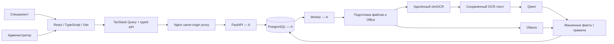

# Архитектура и границы реализации

Дата: 10.10.2026. Детальная проектная архитектура — [specs.md](specs.md). Реализованы frontend M14, инфраструктура, каталог, прикладной API, worker и OCR/Qwen/Ollama-адаптеры. Полное покрытие форматов и совместная приёмка остаются впереди.

Серверные данные находятся в TanStack Query; формы держат отдельный черновик в React state. Клиент не вычисляет арифметический verdict и не устанавливает pass. Ответы API проверяются Zod. Polling заявок/состава и незавершённого run — раз в две секунды; результаты обновляются независимо от решения человека.

Все экраны вызывают операции типизированного openapi-client.ts через client.ts; adapters.ts преобразует CON01 в локальные модели React. Клиент и admin передают expected_revision; admin сохраняет полный definition. 409 обновляет защищённые запросы, сохраняя session query; формы требуют явной сверки перед сменой ревизии. Решение привязано к подтверждённому снимку отчёта, неоднозначный повтор сохраняет исходное тело/ключ. Исторические запуски берутся из аудита, текущий Decision — из PackageDetail; устаревание явно передаёт сервер. В браузере нет ключей OCR/Qwen и классификации файлов по названиям.

PostgreSQL, миграции, bytea, сессии и права реализованы A в INF01. В OCR01/QWN01/LOC01/INT01 добавлены адаптеры, сохранение OCR, проверка фактов/источников, прикладной API и worker; A проверил один реальный сценарий ЕГРН. B подключил восстановление сессии/CSRF через GET sessions. Office-конвертер, полная приёмка документов и Docker-прогон не завершены. Общий Compose принадлежит A; B предоставляет Dockerfile и конфигурацию Nginx.
