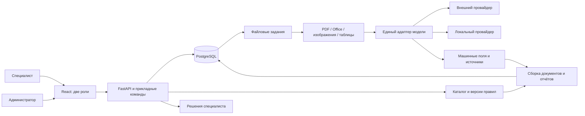

# Кейс 3. «Агентство инноваций»: обновлённый анализ и архитектура

Редакция 2, 10.10.2026. Основание: исходное положение и дополнительный файл `Кейс_3_Агентство_инноваций_НАТАША.docx` (далее — ТЗ кейса). Этот анализ заменяет прежние предположения о неполноте предметного описания. Подробная инструкция по модулям и реализации — [specs.md](specs.md); [summary.md](summary.md) остаётся сводкой исходного положения.

**Вывод:** выбранный модульный монолит остаётся подходящим, но первая версия архитектуры не покрывала весь новый обязательный объём. Нужны административный интерфейс и декларативные правила, Office-конвейер, два работающих модельных провайдера, долговечная обработка по файлам и самостоятельное решение специалиста. Смена стека целиком не требуется.

Документ описывает проект, не реализованный и протестированный продукт. Формат работы по ТЗ — команда 3–5 человек, 7–10 часов; исходное положение допускало 2–5, это организационное расхождение отмечено отдельно.

## 1. Что изменилось и почему

| Новое требование | Что было в прежнем анализе | Решение |
| --- | --- | --- |
| PDF/DOC/DOCX/XLS/XLSX/JPG/PNG, несколько файлов одного вида | В основном PDF и изображения | Добавить стратегии Word/Excel и Office-превью, не ограничиваться одним PDF-рендером |
| Приём сразу, фон, готовность по файлам, восстановление | Очередь предлагалась как удобство; один job на run | Сделать очередь обязательной, отдельные file jobs и версионированную агрегацию |
| Администратор через UI меняет программы, перечни и правила | Каталог предполагался подготовленным разработчиком | Собственные административные формы, черновики/публикация, типизированные семейства правил |
| Минимум внешний и локальный провайдеры | Внешний можно было реализовать позднее | Включить оба в базу, переключать конфигурацией и показать на защите |
| Обязательные ИНН/суммы между документами | Междокументные сверки отнесены к бонусам | Реализовать проверки 4.3 в базе, несмотря на частичный дубль в бонусах 7.3 |
| Отсутствие условного документа — замечание | Могло трактоваться как error | Разделить обязательность, применимость и severity |
| Арифметика на вычитанных числах | Общие effective facts могли включать ручные значения | MachineReport считать на машинных фактах; ручные исправления не подменяют результат |
| Принять/вернуть/отклонить решает специалист | Была только автоматическая оценка | ApplicationDecision с автором, причиной и ревизией, отдельно от machine verdict |
| Известны виды, программы, документация | Всё ожидалось от организатора | Преднастроить известное, оставить только конкретные противоречия открытыми |

## 2. Известный предметный объём

Восемь видов: **заявление, согласие на ПД, сертификат, презентация, обоснование затрат, банковская выписка, документ на недвижимость, гарантийное письмо**. Система поддерживает все виды; конкретной программе нужен свой набор.

| Программа | Обязательные | Условные |
| --- | --- | --- |
| Инновационный проект | Заявление, согласие, презентация, обоснование, выписка, гарантийное письмо | Сертификат |
| Обустройство пляжа | Заявление, согласие, обоснование, выписка, недвижимость | Декларация ГИМС |
| Модернизация производства | Заявление, согласие, обоснование, выписка, гарантийное письмо, недвижимость | Сертификат |

Минимальные поля по всем видам перенесены в раздел 1.2 [specs.md](specs.md). Они оцениваются по логическому документу, который может состоять из нескольких файлов. Развороты/приложения не должны ошибочно считаться самостоятельными неполными документами.

Обязательные проверки: дата не в будущем; действующий срок; ИНН из 10/12 цифр и согласованность ИНН; непустая презентация; кадастровый формат; собственные средства не менее 50% расходов; согласованность запрашиваемой суммы. Каждая проверка имеет отдельное объяснение и источник данных. Просроченный документ принимается и помечается проблемным, не исчезает из пакета.

Явный выбор программы специалистом закрывает сценарий 3.1; автоматическое определение программы из заявления дано как альтернатива. Государственные реестры, юридическая аутентификация документов, почта/личный кабинет заявителя, обучение модели с нуля и мобильное приложение не требуются.

## 3. Стек и его уточнения

| Часть | Выбор | Причина |
| --- | --- | --- |
| Два рабочих места | React, TypeScript, Vite, TanStack Query | Общие компоненты и API, разные роли/маршруты; собственные формы администратора |
| API и предметная логика | Python, FastAPI, Pydantic | Схемы, удобная интеграция извлечения и серверных правил |
| БД | PostgreSQL, SQLAlchemy, Alembic | Пакеты, версии, исходники, job state и журнал |
| Очередь | Python worker + PostgreSQL jobs | Долговечные задания анализа файлов и агрегации, без отдельного брокера для MVP |
| PDF/изображения | pypdfium2, Pillow | Рендер, исходные страницы и нормализация |
| Word/Excel | python-docx, openpyxl, xlrd, заменяемый OfficeConverter | Реальные DOC/DOCX/XLS/XLSX, таблицы/адреса ячеек и просмотр |
| Модель | GigaChatProvider + OllamaProvider | Реальный внешний сервис и локальная модель, общий контракт |
| Правила | Типизированные определения + реестр Python-операций, Decimal | Изменение порога/перечня/bindings без кода, воспроизводимая арифметика |
| Развёртывание | Compose, volumes, изолированный Office-конвертер, HTTPS | Повторяемый запуск и сохранность данных |

FastAPI по-прежнему предпочтителен при знаниях Python/TypeScript: модель, нормализация и арифметика находятся в одной экосистеме. Django — равноценная альтернатива для опытной Django-команды, но стандартная админка прямо не заменяет собственный admin UI. Переход на Java/NestJS без соответствующей компетенции увеличит интеграцию. Микросервисы, отдельный брокер и универсальный BPM-конструктор за 7–10 часов не обоснованы.

**Office:** практический конвертер — LibreOffice headless за интерфейсом OfficeConverter; его поддержка headless/конверсии документирована. [LibreOffice CLI](https://help.libreoffice.org/latest/en-US/text/shared/guide/start_parameters.html). При этом MPL-2.0 нужно сопоставить с неоднозначным запретом лицензий в исходном положении; отделение процесса не решает вопрос автоматически. Альтернативный адаптер возможен на Apache OpenOffice/UNO после проверки форматов. [LibreOffice licenses](https://www.libreoffice.org/licenses/), [OpenOffice licenses](https://www.openoffice.org/license.html).

Превью Office — производное представление с доступным оригиналом. В Excel нельзя ограничиваться первым листом или печатной областью. `openpyxl` не вычисляет формулы: если сохранённого значения нет, оно неизвестно, а не равно нулю. [openpyxl formulae](https://openpyxl.readthedocs.io/en/stable/simple_formulae.html).

**Провайдеры:** GigaChat выбран как подходящий к контексту внешний вариант, но ТЗ допускает другой доступный сервис. Его адаптер учитывает авторизацию, файлы и ограничения вложений; название модели/адрес задаются настройкой. [GigaChat API](https://developers.sber.ru/docs/ru/gigachat/api/reference/rest/post-chat). Локальный кандидат — Ollama с `qwen3-vl:4b-instruct`; на показе второго провайдера допустима меньшая модель, и равное облаку качество специально не требуется. [Ollama model](https://ollama.com/library/qwen3-vl:4b-instruct). Качество основного рабочего режима на восьми видах всё равно проверяется отдельно.

## 4. Архитектура и сценарий

1. Специалист выбирает программу и загружает несколько файлов. После фиксации байтов, метаданных и заданий API возвращает квитанцию; конверсия/модель выполняются позднее.
2. Каждый файл обрабатывается независимо. Источник значения — страница, текстовый блок или sheet/cell; UI показывает принятые, обрабатываемые и готовые файлы.
3. Фрагменты объединяются в логические документы по содержимому и реквизитам. Одинаковый вид не означает один и тот же документ; конфликтующие значения не перезаписываются последним файлом.
4. Каждая готовность файла увеличивает progress_version и запускает пересборку отчёта. Пока не готовы все входы, возможный дефицит помечается pending; полный pass ещё не выдаётся.
5. Сервер применяет комплектность и правила к машинным фактам. Условный дефицит — warning; неизвестная сумма — attention; обоснованное нарушение — error. Готовность pipeline и предметный результат различаются.
6. Специалист исправляет тип при необходимости; система сохраняет авторство, заново извлекает поля и пересчитывает результат новой ревизии.
7. Специалист отдельно принимает, возвращает или отклоняет заявку. Автоматический pass этого не делает.
8. Администратор меняет правило/перечень через UI, публикует версию. Её явное применение к заявке создаёт новый снимок и проверку, не переписывая историю.

Проверка публикации включает input revision, requested run ID, progress_version и lease token. Поэтому ни поздний worker, ни поздний неполный отчёт не заменяет более актуальный результат. Границы домена, repository/UoW и заменяемые адаптеры предыдущей архитектуры сохранены.

## 5. Спорные места и принятые проектные ограничения

| Проблема ТЗ | Решение в архитектуре | Что нужно уточнить |
| --- | --- | --- |
| ГИМС не входит в закрытую восьмёрку, но есть в программе/сроках | Дополнительный явно помеченный тип, предварительная классификация/срок при наличии; отсутствие только warning | Входит ли в обязательный набор распознавания, каков минимум полей |
| Нет точных условий по типу проекта | Редактируемый predicate и явный контекст true/false/unknown; unknown даёт внимание | Фактические условия сертификата/ГИМС |
| В обосновании нет поля «запрашиваемая субсидия», но требуется равенство сумме заявления | Дополнительный машинный operand только при явном наличии, UNKNOWN иначе; binding через admin UI | С какой именно суммой обоснования сравнивать |
| ИНН нужен между документами, но в таблице полей указан только у заявления | Читать присутствующий ИНН заявителя дополнительно, сохранять роль организации; не выдумывать отсутствующий | Нужен ли ИНН в каждом виде; что делать с реквизитами гаранта |
| ИНН-сверка есть в базе 4.3 и бонусах 7.3 | Реализовать в базе | Уточнить начисление бонуса, а не сокращать функционал |
| «Принятый формат» кадастрового номера не определён | Редактируемый regex, статус неподтверждённого параметра; при отсутствии образцов UNKNOWN | Точная маска и примеры |
| Нет численных лимитов/метрик качества | Конфигурируемые лимиты, замеры по видам/форматам | Размеры/страницы, оборудование, критерии закрытого набора |

Запрашиваемая субсидия не равна автоматически всем расходам или расходам минус собственные средства. Доля считается на извлечённых Decimal-значениях, без предварительного округления процента. Для отсутствующего операнда нельзя поставить ноль и объявить правило пройденным.

Поле, исправленное человеком, может отображаться рядом и учитываться в отдельной вспомогательной ветке, но не подменяет обязательную автоматическую арифметику. Это ограничение прямо следует из ТЗ 3.2.

## 6. Приоритеты и план проверки

Баллы не изменились: классификация 25, комплектность 15, поля/правила 20, модель 15, рабочее место 10, инженерия 10, владение 5 — всего 100, бонусы до 10 после обязательного объёма. Отдельного веса admin UI/фоновой обработки в таблице нет, но их обязательность закреплена разделами 3–5 и не исчезает из-за этого.

Порядок реализации: ранний реальный прогон Office и двух провайдеров → роли/БД/пакетный приём/очередь → восемь схем и три программы → правила/admin UI → версии/повторы/ручной тип/решения → живая приёмка и документация. Подробная сетка на 7–10 часов — в [specs.md](specs.md).

Ключевые проверки:

- Настоящие legacy DOC и XLS наряду с PDF/DOCX/XLSX/JPG/PNG; смешанные пакеты и несколько файлов одного документа.
- Готовый результат одного файла виден до окончания всего пакета; перезапуск не теряет работу.
- Условный дефицит даёт замечание; обязательный — ошибку после завершения определения состава.
- Пороги 49.99% / 50% / выше; даты, сроки, междокументные ИНН/суммы и происхождение чисел.
- Администратор без кода меняет 50% на 60% и добавляет документ в перечень, затем результаты действительно меняются.
- Исправление типа отмечается как действие человека; новый расчёт извлекает значения из файла.
- Оба провайдера вызываются реально после смены настройки; тайм-аут/невалидный ответ даёт понятный повтор, не шаблон.
- Подмена браузерного вердикта и прямой доступ без прав не работают; окончательное решение человека отдельно от оценки системы.
- Новые/закрытые образцы не привязаны к именам или хешам. ТЗ 4.4 допускает обнуление блока при резком падении качества; численная граница не определена.

## 7. Поставка и границы MVP

ТЗ 5.5 требует отдельных файлов: инструкция запуска; схема с пояснениями; журнал 3–6 решений; пошаговый переход на локальную модель; ограничения и план следующих 10 часов; отчёт об использовании ИИ-ассистентов. Репозиторий доступен судьям. Git — с начала работы, осмысленная история, ориентир ≥15 коммитов, участие всех членов команды, никаких секретов/окружений/дампов. На защите нужно объяснять код и выполнить небольшое изменение за 10–15 минут.

Экспорт, расширенная история по организации, статистика, напоминания и помощник — после базы. Простая журнализация каждой проверки, административные формы, машинная сверка ИНН/сумм, дозагрузка и сообщения о недостающих документах уже относятся к обязательному объёму. Бессрочное хранение и интеграция с почтой/реестрами в MVP не включаются.
