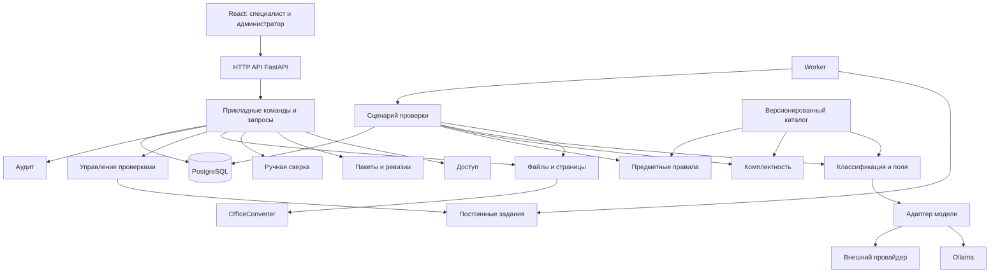

# Кейс 3 — модульная архитектура и инструкция по реализации

Редакция 2, 10.10.2026. Источники: исходное положение, [summary.md](summary.md), новый файл `Кейс_3_Агентство_инноваций_НАТАША.docx` (далее — **ТЗ кейса**, ссылки на разделы относятся к нему), [обновлённый анализ](case_3.md). Спецификация описывает будущую реализацию; код и качество моделей не проверены.

**Цель:** специалист загружает пакет, получает предварительную проверку по каждому файлу и пакету, сверяет исходники и принимает решение. Администратор через собственный интерфейс настраивает программы, перечни и правила.

**Основное решение:** модульный монолит Python/FastAPI, PostgreSQL, отдельный worker, React/TypeScript; два реальных адаптера модели — внешний и локальный. Модель распознаёт, сервер вычисляет, специалист принимает окончательное решение. Прежние 15 логических модулей сохраняются, но их обязанности уточнены.

## 1. Обязательный объём после уточнения

1. Поддержать **PDF, DOC, DOCX, XLS, XLSX, JPG, PNG**, пакетную загрузку, несколько файлов одного логического документа и дозагрузку в существующую заявку (ТЗ 3.1).
2. Принимать файлы без ожидания модели, обрабатывать **в фоне**, публиковать результаты по мере готовности каждого файла и восстанавливать работу после перезапуска (3.1–3.2, 4.4).
3. Автоматически распознавать восемь видов из 4.1 по содержимому и вычитывать минимальные поля. Расширение допустимо использовать для декодирования контейнера, но не для классификации вида.
4. Проверять три программы, обязательные, условные и лишние документы. Отсутствующий условный документ — **замечание, а не ошибка**, даже когда условие применимости известно (4.2).
5. Проверять поля, долю собственных средств, согласованность сумм и ИНН на сервере. Обязательная арифметика использует **извлечённые моделью числа**; ручной ввод не заменяет её (3.2, 4.3).
6. Иметь собственные desktop-интерфейсы **специалиста и администратора**. Изменение перечня/порога/правила через UI без редактирования кода демонстрируется на защите (3.4, 5.2).
7. Реализовать **минимум два провайдера**, внешний и локальный, единый слой вызова и переключение настройкой; хранить промпты/разбор ответа в репозитории. На показе переключения допускается маленькая локальная модель без оценки качества её ответа (5.3).
8. Отделить автоматический результат «пройден / требует внимания / есть ошибки» от решения специалиста «принять / вернуть на доработку / отклонить» (3.3).
9. Сохранять исходники, проверки, решения, правки и журнал; закрыть доступ к данным, обрабатывать сбои без выдуманного успеха (4.4, 5.1).
10. Подготовить шесть видов документации из 5.5; вести Git с начала работ, с участием всех членов команды и ориентиром не менее 15 осмысленных коммитов (5.4).

План рассчитан на **3–5 человек и 7–10 часов** по ТЗ кейса. Исходное положение допускает команды от двух человек; это организационное расхождение требует уточнения, но не меняет архитектуру.

### 1.1. Изменения относительно редакции 1

| Прежнее решение | Обновление | Модули |
| --- | --- | --- |
| Каталог и формулы ещё не получены | Есть восемь видов, три программы и базовые проверки; спорные привязки перечислены отдельно | M04, M07, M08 |
| Очередь — рекомендуемое удобство | Фоновая обработка и восстановление теперь обязательны | M10, M11 |
| Один job на весь пакет | Отдельные задания анализа файлов и повторная сборка результата пакета | M03, M05, M10, M11 |
| PDF и изображения | Добавлены Office-конвертер, чтение таблиц и исходная адресация ячеек | M03, M05 |
| Внешний адаптер можно добавить позже | Внешний и локальный провайдеры входят в первую поставку | M06, M15 |
| Конфигурация каталога через JSON/подготовку разработчиком | Собственный административный UI для редактирования и публикации | M04, M08, M14 |
| Условный дефицит мог стать ошибкой | Severity условного дефицита — warning/attention | M07, M10 |
| Проверки использовали общую смесь ручных и машинных значений | Обязательный автоматический расчёт основан на machine facts; исправленный человеком отчёт отделён | M08, M09, M10 |
| Междокументные сверки отложены в бонусы | Сверка ИНН и суммы входит в базу по 4.3; бонусный дубль не уменьшает объём | M05, M08 |
| Был только автоматический вердикт | Добавлена самостоятельная сущность решения специалиста | M02, M14 |

### 1.2. Преднастроенный предметный каталог

Минимум полей относится к **логическому документу**, собранному из страниц/файлов. Не требуется наличие всех полей на каждом отдельном развороте. Все перечисленные извлекаемые поля входят в схему; отсутствие поля сверх минимума само по себе не означает, что документ не разобран.

| Вид / ID | Что извлекается | Минимум по ТЗ 4.1 |
| --- | --- | --- |
| Заявление / `application` | Организация, ИНН, ОГРН, запрашиваемая сумма, дата, подписант | Организация, ИНН, запрашиваемая сумма, дата |
| Согласие на ПД / `consent` | ФИО, паспортные данные, дата | ФИО, дата |
| Сертификат / `certificate` | Номер, орган сертификации, дата выдачи, срок действия | Номер, срок действия |
| Презентация / `presentation` | Наименование проекта, краткое описание | Наименование проекта; содержимое непустое |
| Обоснование затрат / `cost_justification` | Общая сумма расходов, собственные средства, статьи расходов | Общая сумма расходов, собственные средства |
| Выписка / `bank_statement` | Организация, номер счёта, остаток, дата | Организация, остаток, дата |
| Недвижимость / `property_document` | Кадастровый номер, площадь, назначение, адрес | Кадастровый номер |
| Гарантийное письмо / `guarantee_letter` | Организация-гарант, сумма, дата, подписант | Организация, сумма, дата |

| Программа | Обязательные документы | Условные документы |
| --- | --- | --- |
| Инновационный проект | Заявление, согласие, презентация, обоснование затрат, выписка, гарантийное письмо | Сертификат |
| Обустройство пляжа | Заявление, согласие, обоснование затрат, выписка, недвижимость | Декларация ГИМС |
| Модернизация производства | Заявление, согласие, обоснование затрат, выписка, гарантийное письмо, недвижимость | Сертификат |

В MVP специалист выбирает программу явно; её автоматическое определение из заявления в 3.1 дано как альтернатива, а не отдельная обязательная функция. Все восемь видов поддерживаются системой, но не все восемь требуются в каждом пакете.

### 1.3. Реестр правил и проектные решения по неопределённостям

| Правило | Привязка и исполнение | Источник / оговорка |
| --- | --- | --- |
| Минимальные поля | Проверка схемы логического документа; невычитанное поле → документ не разобран, внимание | 4.1; не подставлять значения вручную для успешной автоматической приёмки |
| Дата не в будущем | Сравнение извлечённой даты с зафиксированной локальной датой проверки | 4.1, 4.3 |
| Срок не истёк | Извлечённый конец срока сравнивается с датой проверки; дата окончания сегодня принимается включительно как явно заданная проектная политика | 4.3; неопределённый срок/единица → attention |
| ИНН | Строка из 10 или 12 ASCII-цифр; без обязательной проверки контрольного разряда, которой в ТЗ нет | 4.1, 4.3 |
| Один ИНН заявителя | Сравнивать явно извлечённые ИНН той же организации-заявителя; сохранять, чьи это реквизиты | 4.3; ИНН гаранта не подменяет ИНН заявителя; роли сторон уточнить |
| Непустая презентация | Наименование проекта и содержательная информация в документе; ненулевого размера файла недостаточно | 4.1 |
| Кадастровый формат | Редактируемое поле `pattern` в правиле, проверка полного совпадения | Точная маска в 4.1 не определена; стартовую маску сверить с примерами, не выдавать её за нормативную |
| Доля собственных средств | `own_funds >= Decimal('0.50') * total_expenses`; единицы должны совпадать; нет округления процента перед сравнением | 4.1, 4.3; нечисловое/неопределённое значение → attention; при неположительной базе отношение требует уточнения |
| Согласованность суммы | `application.requested_amount == cost_justification.requested_subsidy_amount`, если в обосновании явно найдена именно запрашиваемая субсидия | Проектная привязка для 4.3: такого поля нет в таблице 4.1; нельзя молча сравнивать с общей суммой расходов или выводить его как расходы минус собственные средства |

Обе суммы для обязательной арифметики должны происходить из содержимого файлов. Дополнительный `requested_subsidy_amount` извлекается только при явном наличии; при отсутствии проверка возвращает `UNKNOWN` и объясняет, какого операнда нет. После разъяснения организатора binding меняется через административный UI.

**Оставшиеся противоречия:** декларация ГИМС отсутствует в закрытой восьмёрке, но требуется условно в 4.2 и имеет правило срока в 4.3; точные условия по типу проекта не заданы; перечень извлекаемых ИНН вне заявления и роли организаций не уточнены; сверка ИНН одновременно названа базой (4.3) и бонусом (7.3). Для планирования действует более полный обязательный объём 4.3.

**ГИМС:** завести дополнительный каталожный тип `gims_declaration` как явно помеченное расширение, поддержать определение/сверку и извлечение срока, если он читается; не объявлять его девятым формальным условием допуска и не придумывать обязательный минимум полей. Отсутствие декларации в пляжном пакете даёт warning. Границу закрытого набора нужно подтвердить у организатора.

**Условия:** хранить предикат отдельно от severity. До выдачи точных условий использовать явный контекст проекта `true/false/unknown`, подтверждаемый специалистом, и редактируемые администратором предикаты. Неизвестное условие → внимание; отсутствие условного документа никогда не повышать до error автоматически. Это временная проектная политика, не выведенная из закона.

**Неподтверждённая кадастровая маска:** в seed допустима только помеченная проектная маска по примерам; при отсутствии примеров проверка возвращает `UNKNOWN` и требует настройки, а не фиктивный PASS. Базовый каталог восьми видов при этом известен и реализуется независимо от одного спорного параметра.

Не нужны интеграции с госреестрами, юридическая экспертиза подлинности, обучение модели с нуля, почтовый/заявительский документооборот, мобильные приложения и бессрочный архив (ТЗ 6). Сохранность во время проверки и протоколирования остаётся обязательной.

## 2. Общая архитектура и стек



Схема показывает взаимодействия во время исполнения. Правила импортов и владение данными определены ниже: стрелка к БД не разрешает модулю читать чужие таблицы напрямую.

| Область | Выбранный стек | Назначение |
| --- | --- | --- |
| Frontend | React, TypeScript, Vite, TanStack Query; знакомая команде библиотека компонентов | Экраны, формы, состояние серверных запросов, обновление статусов |
| HTTP и схемы | FastAPI, Pydantic | Транспорт, проверка формы запросов, OpenAPI |
| Предметная логика | Python, dataclasses/enum, Decimal, typing.Protocol | Сущности, правила, типизированные порты |
| Данные | PostgreSQL, SQLAlchemy, Alembic | Постоянное хранение, транзакции, миграции |
| Файлы | bytea/BlobStore, pypdfium2, Pillow, python-docx, openpyxl, xlrd, OfficeConverter | Исходники, страницы, DOC/DOCX и XLS/XLSX с адресами ячеек |
| Модель | GigaChatProvider как выбранный внешний адаптер + OllamaProvider; httpx | Два реализованных провайдера, переключение конфигурацией |
| Фоновые задачи | Отдельный Python-процесс, PostgreSQL jobs | Длительные операции, аренда задания, восстановление |
| Эксплуатация | Docker Compose, HTTPS reverse proxy, постоянные volumes, структурированные логи | Воспроизводимый стенд |
| Проверки реализации | pytest, интеграционные тесты с PostgreSQL, Playwright | Предметные правила, транзакции, пользовательские пути |

Рабочую модель для качества выбирают по открытому набору всех восьми видов. Отдельно проверяют небольшой локальный вариант для обязательной демонстрации переключения; равное облаку качество на этом показе ТЗ 5.3 не требует. Версии библиотек, runtime, образов и моделей фиксируются после первого совместимого запуска в lock-файлах и манифесте; использование плавающего `latest` в сдаваемой сборке не допускается проектом.

## 3. Правила модульности

### 3.1. Слои модуля

| Слой | Содержимое | Разрешённые зависимости |
| --- | --- | --- |
| `domain` | Сущности, value objects, инварианты, чистые функции | Стандартная библиотека и минимальные общие типы; без HTTP, SQLAlchemy и SDK модели |
| `application` | Команды, запросы, сценарии, порты хранилища и внешних функций | Собственный domain и публичные контракты нужных модулей |
| `adapters` | SQLAlchemy-репозитории, HTTP-провайдеры, рендеры | Реализуют порты application; могут использовать внешние библиотеки |
| `public` | Экспортируемые DTO, фасад, ошибки, интерфейсы | Стабильный контракт, не ORM-объекты |

Публичный фасад — ограниченный набор операций модуля. Другой модуль использует этот фасад или порт, но не импортирует внутренние сервисы и таблицы. Внутренние подкомпоненты не нужно превращать в отдельные сервисы или собственные универсальные фреймворки.

### 3.2. Владение и транзакции

- Каждая таблица и каждый изменяемый агрегат имеют одного владельца-модуля. Запись в чужую таблицу запрещена; межмодульная связь передаётся через ID и DTO.
- Команда верхнего уровня определяет границу **Unit of Work** — короткой транзакции бизнес-операции. Вызванные фасады присоединяются к ней через абстрактный `TransactionContext`, но не делают собственный commit.
- SQLAlchemy Session скрыта внутри инфраструктурного адаптера. Репозитории связываются с одной транзакцией в composition root — месте сборки приложения.
- Модель, рендер, скачивание и загрузка во внешнее хранилище выполняются вне транзакции предметных данных. После завершения проверяются версии и право публикации результата.
- Простые запросы чтения отделены от команд изменения, но отдельная CQRS-инфраструктура и event sourcing для MVP не нужны.
- Общий `shared` содержит только ID, технические ошибки, Clock, TransactionContext и небольшой набор общих контрактов. Он не становится складом бизнес-логики.

Порты в Python можно задавать через `Protocol`; внедрение зависимостей FastAPI используется на транспортной границе, а доменные классы получают зависимости через конструктор. [Python Protocol](https://docs.python.org/3/library/typing.html#typing.Protocol), [FastAPI Dependencies](https://fastapi.tiangolo.com/tutorial/dependencies/). Управление транзакцией скрывается за проектным UoW, реализуемым средствами SQLAlchemy. [SQLAlchemy Transactions](https://docs.sqlalchemy.org/en/20/orm/session_transaction.html).

### 3.3. Что означает «легко заменить»

Замена не требует переписывать сущности пакета и правила. Она может требовать нового адаптера, его контрактных тестов, конфигурации и миграции существующих данных. Замена PostgreSQL другой СУБД не объявляется сменой одной строки настройки: SQL очереди, типы хранения и миграции останутся инфраструктурной работой.

## 4. Карта модулей

| ID | Модуль | Функционал | Основной стек |
| --- | --- | --- | --- |
| M01 | `identity` | Вход, сессии, права | Python, PostgreSQL, библиотека хеширования паролей |
| M02 | `packages` | Пакеты, ревизии, окончательные решения специалиста | Python, SQLAlchemy |
| M03 | `assets` | Пакетный приём семи форматов, страницы и ячейки, превью | Python, BlobStore, парсеры Office, OfficeConverter |
| M04 | `catalog` | Администрирование видов, программ и декларативных правил | Python, Pydantic, JSON, PostgreSQL |
| M05 | `recognition` | Логические документы, классификация, извлечение, нормализация | Python, Pydantic, DocumentModelPort |
| M06 | `inference` | Единый вызов внешнего и локального провайдера | Python, httpx, GigaChat API, Ollama |
| M07 | `completeness` | Обязательные, условные и лишние документы; экземпляры | Чистый Python |
| M08 | `rules` | Предметные проверки и арифметика | Чистый Python, Decimal |
| M09 | `review` | Подтверждения и ручные исправления | Python, SQLAlchemy |
| M10 | `verification` | Снимки, обработка по файлам, постепенный итог пакета | Python, SQLAlchemy, публичные фасады модулей |
| M11 | `jobs` | Доставка и восстановление длительных задач | Python worker, PostgreSQL |
| M12 | `audit` | История значимых действий | Python, PostgreSQL |
| M13 | `http_api` | REST, схемы, ошибки, защищённая выдача | FastAPI, Pydantic |
| M14 | `workbench` | Собственные рабочие места специалиста и администратора | React, TypeScript, TanStack Query |
| M15 | `runtime` | Сборка зависимостей, БД, конфигурация, эксплуатация | SQLAlchemy, Alembic, Compose, logging |

M01–M12 — предметные и прикладные модули серверного проекта; M13 — входной адаптер, M14 — frontend, M15 — техническая сборка. В MVP запускаются API, worker, PostgreSQL, Ollama и web/reverse proxy; Office-конвертер — изолированный процесс/контейнер подготовки. Внешний сервис вызывается через адаптер. Эти процессы не совпадают с пятнадцатью логическими границами модулей.

## 5. Архитектура модулей

### M01. Identity — пользователи и доступ

**Функционал и стек:** аутентификация специалиста/администратора, серверные сессии, отзыв входа, проверка действия над ресурсом. Python, PostgreSQL, проверенная библиотека хеширования паролей; HTTP cookies выставляет M13.

| Сущность / компонент | Функция |
| --- | --- |
| `User`, `Role` | Пользователь, состояние учётной записи, набор разрешённых действий |
| `Session` | Хеш секрета сессии, пользователь, срок, отзыв; секрет не хранится открытым |
| `ActorContext` | Внутренний подтверждённый контекст пользователя, не содержимое произвольного запроса |
| `AccessPolicy` | Решение `authorize(actor, action, resource_facts)` по роли и фактам принадлежности |
| `IdentityService` | Вход, выход, разрешение сессии, изменение состояния пользователя |

**Публичный контракт:** `authenticate`, `resolve_session`, `revoke_session`, `authorize`. Факты доступа к пакету предоставляет M02, поэтому Identity не читает таблицы пакетов. Человек не может самостоятельно прислать себе роль или `actor_id`.

**Паттерны:** Policy для авторизации; Strategy/Adapter для провайдера входа; Repository для пользователей/сессий. В будущем OIDC-провайдер заменяет проверку логина, но прикладные команды по-прежнему получают `ActorContext`.

**Данные и готовность:** владелец `identity_users`, `identity_roles`, `identity_sessions`. Без действующей сессии или прав нельзя получить пакет, результат и байты файла; тестируется обращение напрямую к API, а не только переход между экранами.

### M02. Packages — заявки, ревизии и решения специалиста

**Функционал и стек:** заявка, программа, контекст проекта, состав, входные ревизии и отдельное окончательное решение человека. Python domain, SQLAlchemy-репозитории.

| Сущность / компонент | Функция |
| --- | --- |
| `Package`, `PackageRevision` | Агрегат заявки и неизменяемый состав/профиль на ревизию; права и `row_version` |
| `Attachment`, `UploadBatch` | Привязка принятых файлов, пакетная загрузка и дозагрузка |
| `ProjectContext` | Тип проекта и явно известные/неизвестные признаки применимости условных документов |
| `ApplicationDecision` | `accepted / needs_revision / rejected`, автор, причина, input revision, ссылка на автоматический отчёт при наличии |
| `PackageService`, `DecisionService` | Создание, attach, смена программы/редакции, capture revision, проверка прав, фиксация решения |

**Паттерны:** Aggregate, Immutable Snapshot, Optimistic Concurrency, append-only решения. Операции используют expected revision. Правки входов увеличивают `input_revision`; прогресс модели и само решение специалиста её не увеличивают.

**Решение человека:** автоматический `pass` не принимает заявку. Специалист может зафиксировать самостоятельное решение с основанием, в том числе при замечаниях; сервер не требует выдуманного `pass`. После изменения входов прежнее решение остаётся историческим и помечается относящимся к старой ревизии. M01 проверяет права, M12 фиксирует действие в том же UoW.

**Данные:** `packages`, `package_revisions`, `package_attachments`, `upload_batches`, `application_decisions`. M02 не хранит байты, не распознаёт и не проверяет формулы. Через смену `program_version` и новый запуск специалист применяет опубликованные администратором правила к существующей заявке.

### M03. Assets — семь форматов, пакетный приём и превью

**Функционал и стек:** одновременно принять несколько PDF/DOC/DOCX/XLS/XLSX/JPG/PNG, сохранить оригиналы, выдать быструю квитанцию, затем подготовить содержимое и превью в worker. Python, BlobStore, pypdfium2, Pillow, python-docx, openpyxl, xlrd, отдельный `OfficeConverter`.

| Сущность / порт | Функция |
| --- | --- |
| `FileVersion`, `BlobRef`, `UploadIntent` | Неизменяемые байты, проверенный контейнер, устойчивый приём и повтор |
| `UploadBatchResult` | Список принятых и отклонённых по техническим ограничениям файлов; причины по каждому |
| `PreparedContent`, `SourceFragment` | Страницы, текстовые блоки, таблицы/ячейки с источниками; вход распознавания |
| `SourceLocation` | FileVersion + page/bbox либо sheet/cell range, paragraph/table path; для каждого формата понятная адресация |
| `FilePreparationStrategy` | PDF/image/Word/workbook → общий PreparedContent |
| `OfficeConverter` | Office-файл → изолированное PDF/HTML-превью; байты оригинала не меняются |
| `BlobStore` | `put_immutable`, `head`, `open`, `delete_unreferenced`; сначала bytea, позже другой адаптер |

**Матрица обработки:**

| Формат | Извлечение содержимого | Просмотр рядом с результатом |
| --- | --- | --- |
| PDF | pypdfium2: страницы и встроенный текст | Страницы исходного PDF |
| JPG/PNG | Pillow: декодирование, ориентация и качество | Исходное изображение/нормализованное превью |
| DOCX | python-docx: абзацы/таблицы; OfficeConverter для страниц | Производное превью с явной пометкой и доступом к оригиналу |
| DOC | OfficeConverter → нормализованный документ/страницы | Производное превью и оригинальный DOC |
| XLSX | openpyxl: все используемые листы, ячейки, формулы/сохранённые значения | Табличный viewer с адресами ячеек; Office-превью как дополнительное |
| XLS | xlrd: листы, значения и форматирование, нужное для интерпретации | Табличный viewer; при необходимости Office-превью |

Парсер даёт содержимое, но поля и тип выбираются с реальным участием модели; нельзя заменить модель жёсткими координатами известных файлов. Для таблиц не ограничиваться первой страницей печати/первым листом, не складывать дважды переносы итогов. `openpyxl` не вычисляет формулы; отсутствие сохранённого результата → `unreadable/unknown`, а не ноль. Контролируемый пересчёт Office при необходимости отмечается как производное значение, сохраняются формула и исходник. [openpyxl](https://openpyxl.readthedocs.io/en/stable/simple_formulae.html), [xlrd](https://xlrd.readthedocs.io/en/latest/), [python-docx](https://python-docx.readthedocs.io/en/latest/).

**Конвертер:** практический кандидат — LibreOffice headless с отдельным профилем и временной папкой на задачу, ограничениями времени/памяти, отключёнными макросами, сетью и обновлением внешних ссылок. Headless-конверсия и отдельный профиль документированы; качество вёрстки проверяется на образцах. [LibreOffice CLI](https://help.libreoffice.org/latest/en-US/text/shared/guide/start_parameters.html). Его MPL-2.0 требует отдельного сопоставления с неопределённым запретом «вирусных» лицензий в исходном положении; вынесение в процесс не отменяет условия лицензии. Альтернативный `OfficeConverter` возможен на Apache OpenOffice/UNO после проверки конверсии: официальный проект использует Apache-2.0. [Лицензии LibreOffice](https://www.libreoffice.org/licenses/), [OpenOffice](https://www.openoffice.org/license.html). До фиксации допустимого адаптера нельзя обещать закрытие Office-форматов одним pypdfium2.

**Паттерны и границы:** Strategy для форматов, Adapter для converter/blob, Immutable Asset, Idempotent Command. Приём не ждёт конверсию и модель; бизнес-ошибки, например просроченный сертификат, не являются отказом загрузки. Исходник сохраняется, проблема появляется в проверке. Лимиты байтов/страниц/ячеек — конфигурация, их численные значения ТЗ не даёт.

**Данные:** `asset_files`, `asset_fragments`, `asset_previews`, intents/blob metadata. Выдача оригиналов, таблиц и превью требует одинаковой авторизации. Протокол записи байтов отдельно от регистрации пакета остаётся из раздела 8.1; пакетная квитанция явно сообщает, какие файлы реально приняты.

### M04. Catalog — редактируемые программы и правила

**Функционал и стек:** предзаполненные три программы/восемь видов и собственные административные команды изменения перечня, условий, привязок полей и арифметических параметров. Python, Pydantic, PostgreSQL; React-формы M14. JSON seed нужен для первого старта, но не заменяет UI.

| Сущность / компонент | Функция |
| --- | --- |
| `ProgramDraft`, `ProgramVersion` | Редактируемый черновик и неизменяемая опубликованная редакция |
| `DocumentTypeDefinition`, `FieldDefinition` | Вид, описание для модели, поля, минимум, единицы/нормализация |
| `RequirementDefinition` | Вид/слот, required/conditional/optional, количество, предикат и отдельная severity |
| `RuleDefinition`, `FieldBinding` | Семейство проверки, операнды, порог/regex/сравнение, on_missing, источник требований |
| `CatalogService` | create/update draft, validate, publish, get snapshot; optimistic concurrency |

**Декларативные семейства первой поставки:** `required_fields`, `non_empty`, `matches_regex`, `date_compare`, `ratio_gte`, `amount_equal`, `same_subject_value`. Интерпретатор/обработчики M08 пишутся один раз; 50% → 60%, новое условие/поле/документ в перечне и уровень замечания меняются через формы без правки Python. Произвольный код/SQL/eval не принимается.

**Публикация:** проверить ссылки, типы операндов, допустимые операции, severity условного дефицита и обязательные параметры. Сохранить новую версию и аудит. Исторические проверки не переписываются. Для применения к открытой заявке UI предлагает «Применить редакцию и перепроверить»: смена program_version создаёт новую input revision и run.

**Паттерны:** Versioned Configuration, Declarative Rules, Registry, Schema Validation. Неподтверждённый binding/параметр явно отмечается `needs_clarification`; такая проверка выдаёт UNKNOWN, а UI сообщает ограничение. Отсутствующая реализация семейства — техническая ошибка, не PASS. Блокировать весь известный каталог из-за одного обсуждаемого кадастрового regex не нужно, но скрывать неполноту нельзя.

**Данные:** `catalog_drafts`, `catalog_versions` и определения. Готовность: администратор меняет порог, список и условность, а новый реальный пакет проверяется по ним; обычный специалист не может менять правила.

### M05. Recognition — файлы, фрагменты и логические документы

**Функционал и стек:** серверная классификация каждого файла/фрагмента, извлечение полей и сборка многофайловых документов. Python/Pydantic, `DocumentModelPort` M06; содержимое готовит M03.

| Сущность / компонент | Функция |
| --- | --- |
| `FileAnalysis`, `FragmentClassification` | Автоматический вид/unknown и машинные наблюдения по каждому источнику |
| `DocumentUnitVersion` | Группа SourceFragment из одного или нескольких файлов; один файл также может содержать несколько документов |
| `FieldObservation`, `EvidenceRef` | Машинное значение, исходная строка, известность и SourceLocation |
| `DocumentAssembler` | Сопоставление частей по содержимому/реквизитам; подтверждённые границы и конфликты |
| `RecognitionService`, `FieldNormalizer` | Реальное определение/извлечение через модель и явная нормализация |

**Контракт:** `analyze_file(prepared_content, catalog, pinned_overrides) -> FileAnalysis`; `assemble(file_analyses, grouping_context) -> DocumentUnits`. В модель не передаются пользовательские имя/расширение/порядок как признаки вида. Ей разрешены сами таблицы, текст и визуальные фрагменты, независимо от исходного формата.

**Многофайловость:** минимум оценивается по собранному документу. Разворот без даты не является отдельным неполным заявлением, если дата на связанной странице. Нельзя объединять разные документы лишь потому, что у них один тип, или брать последнее попавшееся число. Неоднозначная связь и конфликт значений требуют внимания; UI позволяет подтвердить состав. Подтверждённые группы и исправленный человеком тип входят в снимок, повторная автоматика их не отменяет.

**Дополнительные факты:** вычитывать явно присутствующий ИНН заявителя в других видах и явно обозначенную запрашиваемую субсидию в обосновании для правил 4.3; не придумывать их отсутствие как ноль и не расширять формальный минимум таблицы 4.1. ИНН гаранта сохраняется с отдельной ролью стороны.

**Паттерны:** Pipeline, Strategy нормализации, Provenance, Document Assembly. Машинные результаты неизменяемы, сохраняются по file/run/version; проверка формул — M08, решения человека — M02. Пользовательский тип сохраняется отдельно от `predicted_type`; после его правки поля заново читаются моделью по нужной схеме.

**Данные:** `recognition_file_analyses`, `recognition_units`, `recognition_classifications`, `recognition_extractions`. Готовность: все восемь видов, семь форматов, разнесённые страницы/файлы, unknown и конфликт, результаты по мере готовности.

### M06. Inference — два реализованных провайдера

**Функционал и стек:** единая точка всех модельных вызовов, внешний и локальный адаптер, настройка model/address, версия промптов и обработка сбоев. Python, httpx, GigaChat API и Ollama.

| Компонент | Функция |
| --- | --- |
| `DocumentModelAdapter` | Реализует порт M05; нормализует vision/text/tabular input и типизированный output |
| `ModelProvider` | capabilities, generate, healthcheck; не знает бизнес-вердикт |
| `GigaChatProvider` | Выбранный внешний адаптер: авторизация, загрузка нужных вложений, вызов доступной модели, разбор ответа |
| `OllamaProvider` | Локальная VLM, первоначальный кандидат qwen3-vl:4b-instruct; реальные вызовы |
| `ModelProfile`, `PromptVersion`, `ModelInvocation` | Настройка, промпты/схемы, версия/время/ошибка вызова без секретов |

ТЗ разрешает любой доступный внешний сервис, GigaChat — проектный выбор. Проверить доступ и vision-возможности выбранной модели в начале работы; название модели и адрес в конфигурации. GigaChat работает с вложениями через file IDs, имеет ограничения числа изображений в сообщении/запросе; адаптер разбивает документы на поддерживаемые части. Нельзя считать его HTTP-формат тождественным Ollama. [GigaChat chat API](https://developers.sber.ru/docs/ru/gigachat/api/reference/rest/post-chat), [авторизация](https://developers.sber.ru/docs/ru/gigachat/api/reference/rest/gigachat-api). Ollama принимает изображения и структурированный ответ; итог валидируется сервером в обоих случаях. [Ollama Vision](https://docs.ollama.com/capabilities/vision), [Structured Outputs](https://docs.ollama.com/capabilities/structured-outputs).

**Паттерны:** Adapter, Strategy/Factory, Anti-Corruption Layer. Ошибки приводятся к общим `ProviderUnavailable`, `ModelTimeout`, `InvalidModelOutput`, `UnsupportedCapability`; повторы ограничены политикой M11. Prompt templates и правила parsing хранятся в `prompts/`, а не в переписке команды.

**Показ переключения:** изменить `MODEL_PROVIDER=external|local` и настройки, перезапустить/перечитать конфигурацию по инструкции, выполнить новый реальный запрос и показать invocation metadata. Старый run остаётся закреплён за прежним профилем; провайдер не меняется в середине обработки. Маленькая локальная модель допустима для этого показа, равная точность двух моделей не заявляется.

**Готовность:** оба адаптера написаны и реально вызываются, есть локальные файлы запуска, инструкция и объяснение различий скорости/оборудования/качества/стоимости/приватности. Fake только в тестах. Автоматическая скрытая отправка локальных документов во внешний сервис при сбое исключена; файлы и инструкции пользователя не могут управлять инструментами модели/правами.

### M07. Completeness — обязательные, условные и лишние документы

**Функционал и стек:** чистая Python-функция сопоставления логических документов с версией требований программы.

| Сущность | Функция |
| --- | --- |
| `RequirementSlot` | Вид, количество, kind required/conditional/optional, predicate и severity |
| `PresenceFact` | Документ/экземпляр и источники, состояние распознавания/сборки |
| `RequirementResult` | found/missing/pending/unknown/not_applicable; обязательность и понятная причина |
| `ExtraDocument` | Найденный документ, не входящий в перечень программы; сам по себе не ошибка |
| `CompletenessService`, `ConditionEvaluatorPort` | Оценка на `facts + definitions + processing_progress` |

**Политика:** отсутствующий обязательный документ → error после завершения анализа состава. Условный требуется и отсутствует → warning; условие неизвестно → attention; заведомо неприменимый → not_applicable. Сертификат с истёкшим сроком не считается отсутствующим: он найден, отдельное правило сообщает проблему.

Пока есть необработанные/несобранные файлы, возможный дефицит показывается как `pending`, не как окончательная ошибка. Минимум полей и экземпляры оцениваются на DocumentUnit, а не на числе загруженных страниц. Повтор одного файла не заполняет два слота; несколько самостоятельных документов одного вида разрешены, выбор экземпляра и конфликт объясняются.

**Паттерны:** Specification/Predicate, Pure Function, Strategy подсчёта. Данных не пишет; отчёт принадлежит M10. Готовность: все три программы, дополнительные документы, ГИМС как оговорённое расширение, неизвестные условия и warning условного дефицита.

### M08. Rules — декларативные проверки на машинных фактах

**Функционал и стек:** интерпретировать определения M04 на сервере, проверять даты/строки/междокументные факты и Decimal-арифметику, возвращать отдельное объяснение каждого правила.

| Компонент | Функция |
| --- | --- |
| `MachineFactSet`, `FactValue` | Факты реального извлечения с источником, ролью организации, единицами и known/unknown |
| `RuleDefinition`, `FieldBinding` | Операция, операнды, параметры и severity; поступают из каталога, не констант use case |
| `RuleRegistry`, `RuleHandler` | Проверенные реализации семейств из раздела 1.3 |
| `ConditionEvaluator` | Типизированные equals/is_true/all/any с трёхзначной логикой для M07 |
| `RuleResult` | PASS/FAIL/UNKNOWN/NOT_APPLICABLE, severity, значения/формула/источники и версия |
| `ArithmeticPolicy` | Decimal, масштаб/единицы/точность и обработка неопределённой базы |

**Обязательная семантика:** доля проверяется как `own >= factor * total`, где seed factor — строка `0.50`; не округлять долю до целого процента. Сверка запрашиваемой суммы имеет два явно настроенных FieldBinding; общую стоимость нельзя автоматически считать запрашиваемой субсидией. Точный baseline ИНН — 10/12 цифр, не внешние реестры и не добавленная проверка контрольной суммы.

**Машина и человек:** обязательный автоматический отчёт использует только `MachineFactSet`. Человек может исправить тип, после чего модель заново читает числа. Ручная правка чисел, если реализована сверх обязательного объёма, формирует отдельный отчёт `basis=human_adjusted`; он не перезаписывает автоматическую проверку и не служит доказательством качества извлечения.

**Изменение без кода:** UI передаёт новое определение в M04; тот же обработчик проверяет новый threshold/pattern/operator/binding. Например, 50% → 60% меняет параметр опубликованной версии. Добавление принципиально нового семейства потребует кода, но обязательные изменения на защите должны укладываться в уже реализованные семейства. Запрещены eval/SQL/команды из документов.

**Паттерны:** Strategy/Registry, ограниченная декларативная модель правил, Value Object, чистые функции. Исключение обработчика — техническая ошибка, отсутствующий операнд — UNKNOWN, отсутствующая реализация — ошибка конфигурации. Decimal и явные правила округления применяются на сервере. [Python Decimal](https://docs.python.org/3/library/decimal.html).

**Данные:** определения у M04, результаты у M10. Готовность: пороги 49.99%/50%/выше, mismatch сумм, будущее/сегодня, истёкший срок, ИНН и источники чисел; также новая редакция через admin UI без изменения кода.

### M09. Review — ручная сверка без подмены автоматического отчёта

**Функционал и стек:** обязательная ручная правка типа, сохранение автора/причины и подтверждение неоднозначных групп страниц. Редактирование полей — возможное дополнительное удобство, не способ закрыть обязательное извлечение. Python, SQLAlchemy.

| Сущность / компонент | Функция |
| --- | --- |
| `ReviewEdit`, `ReviewRevision` | Неизменяемая запись действия и версия правок |
| `TypeOverride`, `GroupingOverride` | Исправленный тип/состав DocumentUnit, привязанный к точным исходникам |
| `FieldOverride` | Отдельное значение человека; не изменяет MachineFactSet |
| `ReviewService` | correct_type, confirm_grouping, get_overrides; опционально correct_fields |
| `ReviewProjectionBuilder` | Показывает рядом machine/human значения и совместимость схем |

**Паттерны:** Append-only History, Overlay для отображения, Optimistic Concurrency, UoW с M02/M12. Смена типа/группы увеличивает input revision; подтверждённые границы фиксируются в снимке. Несовместимые со сменившимся типом старые поля/правки не переносятся автоматически.

**Пересчёт:** после исправления типа модель заново вычитывает поля нужной схемы. Числа ручной правки не подаются в обязательный MachineReport. Дополнительный `HumanAdjustedReport`, если сделан, ясно подписан, имеет собственную версию и не стирает автоматический результат. Решение принять/вернуть/отклонить принадлежит M02, а не этому модулю.

**Данные:** `review_edits`, `review_revisions`; записи M05 неизменяемы. Готовность: действие специалиста видно, исправление переживает перезапуск, два одновременных редактора не затирают друг друга.

### M10. Verification — результаты по файлам и пакету

**Функционал и стек:** снимки входов, автоматический запуск после принятия пакета/дозагрузки, постепенная публикация результатов, общий итог и повтор. Python, SQLAlchemy, фасады остальных модулей.

| Сущность / компонент | Функция |
| --- | --- |
| `InputSnapshot` | Состав, программа/контекст/правки типа, версии каталога, модели, промптов, подготовки и дата |
| `VerificationRun`, `VerificationHead` | Запуск и последний requested/published run; сравнение с актуальной ревизией |
| `FileCheck`, `DocumentCheck` | Состояние, замечания и вердикт файла; агрегированная полнота полей логического документа |
| `RunProgress` | Сколько файлов accepted/running/terminal, progress_version и полнота покрытия |
| `MachineReport` | Обязательная проверка машинных фактов; комплектность, отдельные RuleResults, verdict |
| `FileAnalysisCoordinator`, `PackageAggregator` | Анализ одного файла; затем сборка документов/проверка пакета на версии готовых результатов |

**Исполнение:** M11 запускает AnalyzeFileJob для каждого принятого файла. После сохранения FileAnalysis транзакция увеличивает progress_version и ставит EvaluatePackageJob для этой версии. Специалист видит готовые FileCheck сразу; не ждёт, пока обработаются все остальные файлы.

**Агрегация:** собрать логические документы из готовых фрагментов, применить закреплённую правку типа/групп, вычислить минимальные поля и MachineFactSet, вызвать M07/M08. Локальные проверки готового файла публикуются сразу; проверки минимума многофайлового документа остаются предварительными до сборки. Замечания DocumentCheck и междокументных правил связываются с затронутыми FileCheck через источники; пакетный дефицит остаётся замечанием пакета без фиктивного файла. Пока часть файлов не готова, итог предварительный: дефицит и междокументные сравнения могут быть pending. Полный `pass` запрещён до завершения всего принятого состава и разрешения блокирующей неопределённости.

**Политика:** confirmed error → `issues`; warning/unknown/неполное покрытие → `review_required`; всё применимое завершено без замечаний → `pass`. В UI это «есть ошибки / требует внимания / пройден». Необработанный файл из-за тайм-аута не исчезает: сохраняется error и возможность повтора. Остальные файлы остаются доступными. При системном отказе запуска статус failed, предметного окончательного вердикта нет; частичные результаты показываются явно.

**Паттерны:** Orchestrator, per-file Pipeline, Immutable Snapshot, versioned aggregation, Compare-and-Set. Публикация текущего пакета проверяет input revision, requested run ID, progress_version и lease token задания агрегации. Поздний расчёт по меньшему числу готовых файлов не затирает более новый отчёт.

**Данные:** snapshots/runs/heads, `verification_file_checks`, `verification_document_checks`, `verification_reports`, progress/stage results. Каждый отчёт хранит basis=machine и ссылки на источники; человеческое окончательное решение не входит в автоматический verdict.

### M11. Jobs — обязательная долговечная обработка по файлам

**Функционал и стек:** фоновые задачи и ограниченная конкуренция; восстановление после перезапуска, тайм-ауты и повторы. Python worker + PostgreSQL.

| Сущность / компонент | Функция |
| --- | --- |
| `AnalyzeFileJob` | Подготовить один файл, классифицировать/извлечь, сохранить результат и trigger агрегации |
| `EvaluatePackageJob` | Собрать общий предварительный/финальный отчёт на progress_version |
| `Lease`, `Attempt`, `ExecutionGuard` | Аренда, heartbeat, fencing и причины отказов |
| `JobQueuePort`, `JobHandler` | enqueue/claim/heartbeat/complete/retry/fail; обработчики регистрирует runtime |

**Паттерны:** Durable Queue, Lease/Fencing, At-least-once, Idempotent Consumer. Ключ анализа включает run/file version/версию pipeline; ключ агрегации — run/progress_version. Число worker и одновременных запросов модели ограничивается отдельно от скорости приёма файлов.

Выдача через короткую транзакцию `FOR UPDATE SKIP LOCKED`, затем работа без удержания транзакции. Запись результата файла, увеличение progress_version, создание следующей задачи и завершение текущей выполняются атомарно после проверки lease. Последняя завершающаяся файловая задача обязательно создаёт агрегацию последней версии, чтобы итог не завис навсегда предварительным. [PostgreSQL SELECT](https://www.postgresql.org/docs/current/sql-select.html).

После истечения аренды другой worker повторяет работу; старый token не вправе публиковать результат. Повтор модели возможен, exactly-once внешнее вычисление не обещается. Все результаты привязаны к реальному вызову, тестовые заглушки не попадают в рабочий профиль.

**Данные:** `jobs`, `job_attempts`; исходники отдельно в M03. При замене polling брокером сохранить persistent job state и transactional outbox/relay. Нельзя просто отправить сообщение после commit и потерять его при падении. Для 7–10 часов PostgreSQL-очередь остаётся предпочтительным минимальным вариантом.

### M12. Audit — значимые действия

**Функционал и стек:** фиксировать каждую проверку (что проверено и найдено), изменения, отказы, автора/время и связь с ревизией/результатом. Python, PostgreSQL; обычные технические логи ведёт M15.

| Сущность / компонент | Функция |
| --- | --- |
| `AuditEvent` | Actor, действие, resource ID, старые/новые версии, timestamp, correlation ID |
| `AuditWriter` | `append(event, transaction)` в транзакции предметного изменения |
| `AuditQuery` | Получение разрешённой истории без раскрытия посторонних ресурсов |

**Паттерны:** Append-only Log; Transactional Audit; Correlation ID. Приложение не обновляет и не удаляет совершённые события; это не обещание защиты от администратора БД.

**Данные и готовность:** `audit_events`. Начало/завершение проверки, ошибки и причины отказа, правка типа, смена правил и решение специалиста имеют записи со ссылками на run/file/rule. Для отказанной команды аудит фиксируется отдельно от откатившейся бизнес-транзакции. Сами исправленные значения хранятся в защищённом M09; аудит обычно ссылается на версии, не дублируя всё содержимое документов. Нет предметного изменения без соответствующего аудита при обязательности события. Расширенная история по организации и выгрузка истории могут добавляться позднее поверх этого контракта.

### M13. HTTP API — транспорт и защита границы

**Функционал и стек:** маршрутизация, проверка формы запроса, разрешение сессии, вызов use case, единые ответы и защищённая выдача файлов. FastAPI, Pydantic, OpenAPI.

| Сущность / компонент | Функция |
| --- | --- |
| `Request/Response DTO` | Публичные схемы API; не ORM-модели |
| `SessionDependency` | Получает ActorContext из серверной сессии |
| `CommandController`, `QueryController` | Передают команду/запрос нужному фасаду; не содержат предметных правил |
| `ErrorMapper` | Переводит доменные ошибки в стабильные коды HTTP/API |
| `ContentController` | Проверяет доступ к пакету/файлу и только затем открывает BlobStore |

**Паттерны:** Thin Controller; DTO Mapping; Dependency Injection; API Versioning. HTTP-слой заменяется без изменения M07/M08. Worker вызывает use cases напрямую, ему не нужно имитировать HTTP к собственному API.

**Готовность:** API `/api/v1`, ограниченная пагинация, единый формат ошибки, ограничения тела запроса, безопасные cookies и CSRF-защита изменений. Закрыты исходники, превью и результаты, включая прямые ссылки. Подтверждение загрузки возвращается после надёжной регистрации; ответ `202` на запуск не означает успешную проверку. Контракты приведены в разделе 9.

### M14. Workbench — собственные интерфейсы двух ролей

**Функционал и стек:** desktop SPA на React/TypeScript/Vite, TanStack Query, общая библиотека компонентов; отдельные маршруты/права специалиста и администратора.

| Компонент | Функция |
| --- | --- |
| `SpecialistWorkspace` | Заявки, выбор программы, контекст проекта, пакетная загрузка и дозагрузка |
| `FileProgressList`, `PackageResult` | Принят → определяется → проверен, ошибки/повтор и предварительный/итоговый результат |
| `DocumentViewer`, `TableViewer` | Исходник/производное Office-превью и извлечённые данные рядом; переход к странице/ячейке |
| `TypeEditor`, `DocumentGrouping` | Исправление типа и подтверждение состава многофайлового документа с авторством |
| `DecisionPanel` | Принять, вернуть на доработку, отклонить; причина и отличие от автоматической оценки |
| `AdminWorkspace`, `ProgramEditor` | Три преднастроенные программы, создание черновика, обязательные/условные/дополнительные виды |
| `RuleEditor`, `CatalogPublisher` | Формы операции/операндов/порога/условия/severity, проверка черновика, публикация версии |
| `ApiClient`, query hooks | Стабильный API, ключи кеша package/revision/run/progress_version |

**Паттерны:** Feature Modules, отдельный draft state и server state, Adapter для viewers/API. TanStack Query управляет серверными запросами; локальное состояние формы не устанавливает pass. [TanStack Query](https://tanstack.com/query/latest/docs/framework/react/overview).

**Администрирование:** вместо стандартной админки/API-консоли — собственные формы. Обязательная демонстрация: изменить 50% на 60%, добавить вид в перечень, изменить условность, опубликовать, применить к той же заявке и увидеть новое объяснение. Новые операции за пределами поддержанных семейств не выдаются за no-code возможность.

**Готовность:** результаты файлов обновляются polling по мере готовности; технические коды/traceback не показываются пользователю. Warning условного дефицита отличается от ошибки; неоднозначность формулы/параметра видна. Ручная правка типа не стирает machine prediction. Готовый автоматический отчёт не нажимает за человека «Принять».

### M15. Runtime — сборка, persistence и эксплуатация

**Функционал и стек:** собрать реализации портов, управлять настройками, транзакциями, миграциями и процессами. SQLAlchemy, Alembic, Docker Compose, структурированный logging.

| Компонент | Функция |
| --- | --- |
| `AppContainer` | Единственное место выбора и соединения адаптеров; конструкторы получают явные зависимости |
| `Settings`, `DeploymentProfile` | Типизированные настройки, обязательные значения, проверка совместимости |
| `SqlAlchemyUnitOfWork` | Создаёт короткую транзакцию и связывает репозитории модулей с Session |
| `MigrationRunner` | Упорядоченные миграции перед запуском; таблицы логически принадлежат модулям |
| `Clock`, `IdGenerator` | Заменяемые источники времени/ID для воспроизводимых сценариев |
| `ReadinessReport`, `Telemetry` | Доступность БД/каталога/выбранного провайдера/конвертера, длительности стадий и ошибки |

**Паттерны:** Composition Root; Dependency Injection; Unit of Work; Configuration Validation. Контейнер зависимостей не передаётся внутрь домена как универсальный service locator.

Минимальные профили: рабочий внешний, рабочий локальный и тестовый. Оба рабочих провайдера реализованы. Office-конвертер запускается как изолированный адаптер с отдельным профилем/лимитами; его зависимости, шрифты и лицензии фиксируются в поставке. Настройки: `MODEL_PROVIDER`, отдельные `EXTERNAL_*`/`LOCAL_*` model/address/credentials, `BLOB_BACKEND`, `OFFICE_CONVERTER`, тайм-ауты/лимиты, параметры worker; секреты отдельно от Git и frontend-сборки. Runtime отвергает неизвестный провайдер и неполную обязательную конфигурацию.

**Готовность:** отдельные liveness и readiness; API может показывать существующие пакеты при недоступности модели, но не выдаёт новый успех. Readiness для проверки модели включает реальный малый запрос при подготовке стенда; он не повторяется бесконтрольно на каждом health poll. БД и Ollama недоступны из публичной сети; volume БД/моделей переживает пересоздание контейнеров. Логи содержат ID и причины, а не тексты документов и пароли.

## 6. Межмодульные контракты и владение

| Порт | Потребитель → владелец | Содержание |
| --- | --- | --- |
| IdentityPort | Команды → M01 | ActorContext и разрешение действия над ресурсом |
| PackagePort / DecisionPort | M09/M10/API → M02 | Ревизии, контекст, состав; решения человека отдельно |
| AssetPort / BlobStore | M10/API → M03 / storage adapter | Принятые файлы, фрагменты, оригиналы; непрозрачные BlobRef |
| FilePreparationStrategy / OfficeConverter | M03 → адаптер формата | PreparedContent, preview и SourceLocation |
| CatalogPort | M05/M07/M08/M10 и admin API → M04 | Опубликованный снимок; отдельные команды черновика/публикации |
| DocumentModelPort | M05 → M06 | Содержимое/схема → машинные наблюдения и invocation metadata |
| ReviewPort | M10 → M09 | Зафиксированные тип/группы; ручные значения отдельной проекцией |
| CompletenessPort | M10 → M07 | Presence facts + definitions + progress → found/missing/pending/extras |
| RuleEvaluationPort | M10 → M08 | MachineFactSet + bindings + reference date → RuleResults |
| JobQueuePort | M10/worker → M11 | File jobs, aggregate jobs, аренда, повторы |
| AuditPort | Команды/проверки → M12 | События и ссылки на проверенные входы/результаты |

DTO не содержит ORM/SDK-объектов. Публичные контракты версионируются; конкретные адаптеры собираются только в M15. Один владелец таблицы и UoW-политика раздела 3 сохраняются.

**Общие типы:** `SourceLocation(file_version, page/bbox | sheet/cell | paragraph/table)`; `FactValue(raw, normalized, known_state, subject_role, source=machine|human, evidence)`; `Issue(code, severity, rule_id, message, sources)`; `ProviderMetadata(provider, model, prompt, schema_hash, invocation_id)`; `CommandResult(resource, revision, correlation_id)`.

Десятичные значения передаются строками. EvidenceRef проверяется на принадлежность снимку и включает способ преобразования оригинала. Условный дефицит всегда содержит warning/attention; необработанный файл нельзя спрятать в missing.

## 7. Версии, состояния и гарантии

### 7.1. Версии

Фиксируются FileVersion, DocumentUnitVersion (возможны несколько файлов), ReviewRevision, Package.input_revision, CatalogVersion, PipelineVersion, Model/Prompt/PreparationVersion, Run ID и reference date/timezone. Машинный прогресс не меняет input revision; он меняет `progress_version` конкретного запуска. Окончательное решение специалиста ссылается на input revision и отчёт и не становится входом автоматической формулы.

**Snapshot** хранит исходники, явную программу, контекст условности, версию правил и правок типа/групп. Worker выполняет именно выбранный профиль модели; изменение `MODEL_PROVIDER` влияет на новые запуски. Если старая версия недоступна, это явная ошибка, а не скрытая замена. Реальные выходы модели сохраняются: одинаковые входы не гарантируют побитную повторяемость модели.

### 7.2. Состояния

| Объект/ось | Значения | Интерпретация |
| --- | --- | --- |
| Файл, processing | accepted, determining, checked, processing_error | «Принят / определяется / проверен / ошибка обработки» |
| Запуск | queued, running, completed, failed, cancelled | Независим от предметного вердикта |
| Покрытие | partial, complete | Есть ли ещё ожидающие, ошибочные или неоднозначно собранные входы |
| Актуальность | current, outdated | Соответствует ли текущей ревизии/запрошенному запуску |
| Машинный verdict файла/пакета | pass, review_required, issues | «Пройден / требует внимания / есть ошибки»; provisional до завершения |
| Решение человека | not_decided, accepted, needs_revision, rejected | «Не решено / принять / вернуть / отклонить» |

Системная ошибка всего pipeline → run.failed и нет окончательного вердикта; частичные данные доступны. Ошибка отдельного файла → processing_error и внимание, остальные продолжают обрабатываться. Агрегация может завершиться с неполным покрытием и attention/issues, но не с pass. Предварительные статусы явно помечаются; окончательное решение остаётся действием специалиста.

### 7.3. Инварианты

1. Поддержаны все семь форматов и восемь основных видов; минимум проверяется по DocumentUnit, не каждой странице.
2. Подтверждение загрузки означает сохранённые байты/метаданные и устойчиво запланированную обработку, а не завершение проверки.
3. Каждая пользовательская смысловая правка создаёт новую input revision; старые результаты и решения остаются историческими.
4. Публикация отчёта проверяет input revision, requested run ID, progress_version и актуальность задания; поздний worker не затирает новый результат.
5. Повтор команды с тем же ключом/содержимым даёт один эффект; тот же ключ с другими данными — конфликт.
6. Автоматическая арифметика получает machine facts, а не ручные суммы. Исправленная человеком ветка не заменяет её.
7. Условный дефицит — warning. Неизвестный операнд/условие — attention. Заранее известные форматы/виды не подменяют чтение содержимого.
8. Прошедшая проверка не принимает заявку; человек фиксирует отдельное решение.
9. Правила/перечни/пороги изменяются через собственный admin UI без кода; старая опубликованная версия неизменяема.
10. Оба провайдера работают реально; промпты и парсинг версионируются в Git; нет скрытого fallback на другой режим.
11. Оригинал, превью, ячейки и отчёт защищены одинаково; UUID/хеш не является разрешением доступа.
12. Кеш допускает только реальные ранее полученные результаты с полной версионностью и provenance; подгонка ответов под тестовые файлы запрещена.

## 8. Сквозные сценарии

### 8.1. Пакетный приём и старт обработки

1. M13/M01 проверяют доступ, команда выбирает программу/контекст и ожидаемую ревизию. M03 создаёт batch/intents, принимает несколько файлов с лимитами.
2. BlobStore надёжно сохраняет байты вне предметной транзакции. Технически недопустимые входы получают персональную причину; просроченный сертификат принимается для анализа.
3. Короткий UoW регистрирует все успешно принятые FileVersion, обновляет состав один раз, фиксирует новую revision и InputSnapshot/Run, пишет аудит. Новый запуск охватывает **весь состав снимка**, включая ранее загруженные файлы: для совместимого готового анализа сохраняется ссылка на его реальный источник, для каждого остального файла создаётся AnalyzeFileJob. Начальная агрегация учитывает уже доступные результаты; ни один старый файл не исчезает из прогресса нового запуска. Ответ 202 с принятыми/непринятыми файлами и run ID отдаётся после commit, без ожидания Office/модели. Если не принят ни один файл, состав/ревизия не меняются, UI получает причины отказов без пустого запуска.
4. Если часть байтов сохранена, но commit не состоялся, повтор завершает регистрацию по ключу. Незарегистрированные объекты чистит GC только после окончания intent; GC атомарно помечает удаление, поздняя финализация запрещается.
5. Повтор после потери HTTP-ответа возвращает прежний результат. Дозагрузка сохраняет старые файлы и создаёт новый снимок; переиспользовать можно только совместимые реальные результаты, иначе выполнить разбор заново.

Готовность BlobStore не требует распределённой транзакции с S3. Для PostgreSQL разрешена оптимизация атомарной записи, но внешний storage должен соблюдать тот же проверяемый протокол готовности.

### 8.2. Анализ файла и постепенная публикация

1. Worker получает lease AnalyzeFileJob, M03 готовит контент/превью, M05/M06 определяют вид и вычитывают поля.
2. В транзакции после проверки lease сохраняются наблюдения, состояние FileCheck, прогресс и новая версия агрегации; завершается job и создаётся EvaluatePackageJob.
3. UI получает FileCheck сразу через polling. Другие файлы продолжают обрабатываться; для отстающего или ошибочного файла показана причина.
4. EvaluatePackageJob фиксирует набор готовых результатов, собирает логические документы, считает минимальные поля/комплектность/правила на machine facts. Пока состав не весь готов, дефицит/междокументные правила помечаются pending.
5. Публикация сверяет progress_version и актуальность input/run. Устаревшая агрегация не затирает новую. Завершение последнего файла гарантирует задачу финальной агрегации; неизвестное/ошибки не превращаются в pass.

Порядок составных блокировок: пакет → run/head → job. Claim/heartbeat блокируют только job и освобождают транзакцию до внешнего вызова. Один file job не удерживает БД во время модели/конверсии.

### 8.3. Исправление типа, групп и повтор

Команда проверяет expected revision и права, сохраняет тип/группу с автором, повышает input revision и запрашивает новый run в одном прикладном сценарии. Подтверждённые источники/группы фиксируются; поля заново извлекаются по новой схеме. Старые значения несовместимой схемы не переносятся. Повтор тайм-аута доступен из UI и использует тот же устойчивый механизм; завершённый старый отчёт не переписывается на месте.

Редактирование чисел, если добавлено, даёт явно отдельную human-adjusted ветку. Оно не является способом сделать автоматическую проверку зелёной и не доказывает работоспособность модели.

### 8.4. Изменение правил администратором

Администратор клонирует версию в черновик → редактирует перечень/условие/threshold/bindings → валидирует → публикует. Есть права, optimistic concurrency и аудит. Специалист выбирает новую редакцию для заявки и перепроверяет её; формулы используют новые параметры, исходные файлы остаются теми же. Исторический отчёт по 50% сохраняется, новый по 60% получает другую ссылку на каталог.

### 8.5. Решение специалиста

Специалист рассматривает машинный итог и исходники, выбирает принять/вернуть/отклонить, вводит причину. Сервер сохраняет ApplicationDecision с автором, ревизией и report ID. Никакой автоматический обработчик не вызывает эту команду. При дозагрузке прежнее решение относится к старой ревизии и требует нового рассмотрения.

### 8.6. Сбои

Принятые файлы/задачи остаются в БД; истёкшая аренда восстанавливается, поздняя попытка отклоняется. Retry имеет предел/backoff; непригодный файл не ретраится бесконечно. Сбой одного файла не прекращает приём остальных и не скрывает частичные результаты. В логе и UI различаются транспортный отказ, сбой модели, неизвестный тип и нарушение правила.

## 9. Публичный API

Префикс `/api/v1`; все команды проверяют серверные права и схемы. Административные endpoints недоступны роли специалиста.

| Метод/путь | Назначение |
| --- | --- |
| POST/DELETE `/sessions` | Вход/выход и серверная сессия |
| GET `/programs`, `/programs/{id}/versions` | Доступные опубликованные программы и их редакции для выбора специалистом |
| GET/POST `/packages` | Список/создание; выбор программы |
| GET `/packages/{id}` | Состав, revision, контекст, автоматический результат и отдельное решение |
| POST `/packages/{id}/files` | Multipart-список, expected revision, idempotency key; принятые/ошибки/run ID |
| PATCH `/packages/{id}/configuration` | Контекст проекта или редакция программы с новым снимком |
| POST `/packages/{id}/verification-runs` | Явный повтор/перепроверка, без потери истории |
| GET `/verification-runs/{id}` | Progress version, результаты файлов и пакета, provisional/coverage |
| GET `/files/{id}/content`, `/files/{id}/preview` | Защищённый оригинал и превью |
| GET `/files/{id}/sheets/{sheet}` | Защищённые табличные данные с адресами |
| PATCH `/document-units/{id}/type`, `/document-units/{id}/grouping` | Ручной тип/состав и пересчёт с авторством |
| POST `/packages/{id}/decisions` | Решение специалиста; expected revision, действие, причина, report ID |
| GET/POST/PATCH `/admin/program-drafts` и `/{id}` | Управление черновиками программ, перечнями и условиями |
| PATCH `/admin/program-drafts/{id}/rules/{rule_id}` | Операнды, операция, порог/маска и severity без кода |
| POST `/admin/program-drafts/{id}/validate`, `/{id}/publish` | Проверка и публикация новой версии |
| GET `/packages/{id}/audit` | Ход проверок, замечания, правки, решения |

Ошибки: code/message/details/correlation_id; 401/403(или 404 по политике сокрытия), 409 conflict, 413 limit, 422 invalid command, 503 dependency failure до приёма. После принятого фонового запроса сбой отражается в file/run resource. Пользователю показываются понятные русские состояния, а не трассировки.

## 10. Репозиторий и поставка

```text
frontend/src/features/{session,packages,upload,review,results,decisions,admin}/
frontend/src/shared/{api,viewer,table_viewer,ui}/
backend/src/app/modules/
  identity/ packages/ assets/ catalog/ recognition/ inference/
  completeness/ rules/ review/ verification/ jobs/ audit/
backend/src/app/{http_api,runtime,shared}/
backend/src/app/{main.py,worker.py}
backend/{migrations,tests,evals}/
catalogs/                        # seed: 3 программы, 8 видов, явные оговорки
prompts/                         # классификация, поля, схемы и parsing
infra/                           # API/worker/DB, local model, Office adapter
models/manifest.json             # источники, версии/хеши, лицензии
README.md                        # запуск, настройки, вход, ожидаемый результат
docs/architecture.md             # схема плюс страница пояснений
docs/decisions.md                # 3–6 решений: варианты, выбор, риск
docs/local-model.md              # пошаговое поднятие и переключение
docs/limitations.md              # частичное, неготовое, следующие 10 часов
docs/ai-usage.md                 # что генерировалось, ручная работа, ошибки ИИ
.env.example
.gitignore
```

Шесть видов документации — требования ТЗ 5.5, а не произвольное пожелание. Репозиторий доступен судьям; Git создаётся в начале работ, видны осмысленные шаги и авторство каждого; ориентир ≥15 коммитов не повод имитировать историю. В Git нет секретов, окружений, дампов и случайных архивов. Настоящие ключи провайдеров задаются вне репозитория.

Внутри модулей сохраняются domain/application/adapters/public по необходимости; не создавать пустые слои ради количества. 15 модулей — логические границы, а не 15 процессов. Макросы/внешние ссылки Office отключены, конверсия ограничена, preview явно обозначен как производное. Хранение длится как минимум проверку/протоколирование; бессрочный архив не требуется, конкретная очистка не удаляет активные задания и их источники.

## 11. Заменяемость

| Замена | Изменяется | Стабильная граница |
| --- | --- | --- |
| GigaChat ↔ Ollama | Конфигурация между двумя уже реализованными адаптерами | DocumentModelPort, поля/правила/UI |
| Новый внешний runtime | Новый ModelProvider, контрактные проверки форматов/ошибок | RecognitionService |
| Другая локальная модель | ModelProfile/prompts, оценка качества, новая версия | Пакеты/каталог/арифметика |
| Office-конвертер / PDF-рендер | FilePreparationStrategy/OfficeConverter, проверка отображения/координат | PreparedContent и SourceLocation |
| bytea → object storage | BlobStore, перенос с хешами, протокол готовности/GC | Assets API и pipeline |
| PostgreSQL queue → брокер | Доставка/outbox, persistent state и fencing сохраняются | File/aggregate handlers |
| Порог/перечень/условие/привязка | Admin draft и новая версия каталога | Обработчики существующих семейств, интерфейсы модели |
| Новый класс правила | Новый RuleHandler, валидация и UI-форма параметров | Остальная архитектура |
| UI-компоненты/вход/СУБД | Соответствующие адаптеры и миграции | Предметные сущности при сохранённых гарантиях |

Конкретная база не объявляется заменяемой одной настройкой: транзакции, очередь и миграции требуют реализации. Облачный и локальный провайдеры, наоборот, обязаны переключаться без правки кода после их реализации — это прямое требование.

## 12. План для 7–10 часов

Ориентир для команды 3–5 человек с распределением UI/API/ML/правил; интервалы перекрываются по участникам и не являются измеренной оценкой трудозатрат.

| Время | Приоритет и результат |
| --- | --- |
| 0–1 ч | Реальные примеры всех форматов, доступ к внешней модели и малый локальный вызов, проверка Office-конверсии/лицензии; seed известных программ/полей; регистрация неопределённостей |
| 1–3 ч | БД, сессии обеих ролей, пакетный приём, очередь по файлам, первый сквозной результат в UI, минимальный журнал |
| 3–6 ч | Восемь видов и семь форматов, составные документы, комплектность с warning, арифметика на machine facts, admin-формы порогов и перечней |
| 6–8 ч | Перезапуск/повторы/гонки, частичные результаты, правка типа, решение специалиста, смена правил на той же заявке, показ второго провайдера |
| 8–10 ч | Прогон новых/плохих файлов, документы 5.5, объяснение кода, сценарий живой защиты; бонусы только после базы |

Если доступно 7 часов, сокращать бонусы, декоративный UI, ручной редактор чисел и универсальность конструктора. Нельзя вычеркнуть Office, admin UI, второй провайдер, асинхронность или известные проверки 4.3.

## 13. Проверки реализации и приёмка

Точные тексты С1–С21 в ТЗ всё ещё не приведены; ниже проверяемые сценарии, выведенные из явных требований, без присвоения им официальных номеров.

| Сценарий | Ожидаемый результат |
| --- | --- |
| Все 7 форматов, включая настоящий DOC и XLS | Приняты, содержимое прочитано моделью, исходник/превью и источник поля доступны |
| Все 8 видов с произвольными именами/порядком | Автоматический тип и минимум полей из содержимого |
| Один документ в нескольких файлах; несколько документов одного вида | Поля собираются по источникам; не смешиваются организации/несовместимые экземпляры |
| Большой и малый файл в одной загрузке | Приём не ждёт модели; первый готовый результат виден до завершения всего пакета |
| Отсутствующий обязательный / условный документ | Error / warning соответственно; pending пока ещё есть неопределённые файлы |
| ИНН разной длины и разные ИНН заявителя | Формат/междокументная проверка с объяснением; реквизиты гаранта не подставлены заявителю |
| Свои средства 49.99% / 50% / выше | FAIL / PASS / PASS без предварительного округления процента |
| Не совпали запрашиваемые суммы | Сравнение по явным извлечённым операндам; нет операнда → UNKNOWN, не выдуманная сумма |
| Просроченный сертификат / дата в будущем | Документ сохранён и отмечен как проблемный |
| Изменить threshold 50→60 и перечень через admin UI | Новый расчёт на тех же файлах использует новую версию без правки кода |
| Исправить тип | Авторство видно, новое машинное извлечение, прежний результат устарел |
| Человек принял/вернул/отклонил | Отдельный Decision с причиной и ревизией, не подмена machine verdict |
| Перезапуск во время разбора | Принятые файлы/задачи сохранены; старый worker не публикует повторный результат |
| Поздняя частичная агрегация после более полной | Не затирает новый progress/report |
| Дозагрузка, когда часть старых файлов готова, а часть ещё обрабатывается | Новый run учитывает все файлы снимка; старый результат не становится текущим; последний файл завершает агрегацию |
| Прямые URL/API администратора и файлов без прав | Серверный отказ, понятная причина и журнал |
| Смена провайдера настройкой | Два настоящих вызова, локальная инструкция исполняется, промпты в Git |
| Тайм-аут/неправильный JSON модели | Понятное состояние и повтор, без фиктивных чисел |
| Закрытые/новые образцы | Нет ответов по известным именам/хешам; измеряется качество по каждому виду |

Unit: предикаты, severity, арифметика/unknown, provenance-policy. Contract: два провайдера, семь форматных стратегий, BlobStore. Integration: PostgreSQL/UoW, аренда и версии. E2E: обе роли и полный цикл. Model eval: точность типа/минимума полей по видам, доля unknown, время и ошибки; резкое падение на закрытом наборе по ТЗ 4.4 может обнулить блок. Численного порога «сопоставимости» ТЗ не задаёт.

## 14. Готовность и открытые вопросы

- [ ] Семь форматов, пакетный приём, дозагрузка и результаты по каждому файлу.
- [ ] Все восемь основных видов и минимум полей; многофайловые документы не подменены независимыми страницами.
- [ ] Три программы, обязательные/условные/лишние документы, warning для условного дефицита.
- [ ] Даты, ИНН/согласованность, сумма/доля проверяются по извлечённым фактам; неподтверждённые параметры видны.
- [ ] Собственные интерфейсы специалиста/администратора; изменение обязательных правил без кода.
- [ ] Отдельное решение человека с автором, причиной и ревизией.
- [ ] Реальные внешний и локальный провайдеры, переключение на защите, шаблоны запросов и parsing в Git.
- [ ] Асинхронность, частичные результаты, восстановление и защита от устаревших ответов.
- [ ] Журнал всех значимых проверок/действий/отказов и закрытый доступ к данным.
- [ ] Шесть документов, 3–6 записей решений, история Git и авторство всех участников.
- [ ] Команда объясняет код и выполняет небольшую правку за 10–15 минут на защите.

**Уточнить:** статус ГИМС относительно закрытой восьмёрки; точные условия по типу проекта; какой операнд из обоснования сравнивается с суммой заявления; какие ИНН относятся к одной организации; кадастровая маска и примеры; конкретные размеры/сложность файлов и оборудование; трактовку ограничения лицензий для выбранного Office-конвертера; подробные сценарии С1–С21. Документация 5.5, виды, программы, базовые проверки и семь форматов уже известны — запрашивать их как полностью отсутствующие не нужно.

Пока спорный операнд/параметр не определён, ограничение показывается как UNKNOWN/attention и фиксируется в limitations; приёмка по этой проверке не объявляется закрытой. Предварительная оценка системы никогда не означает назначение субсидии.
